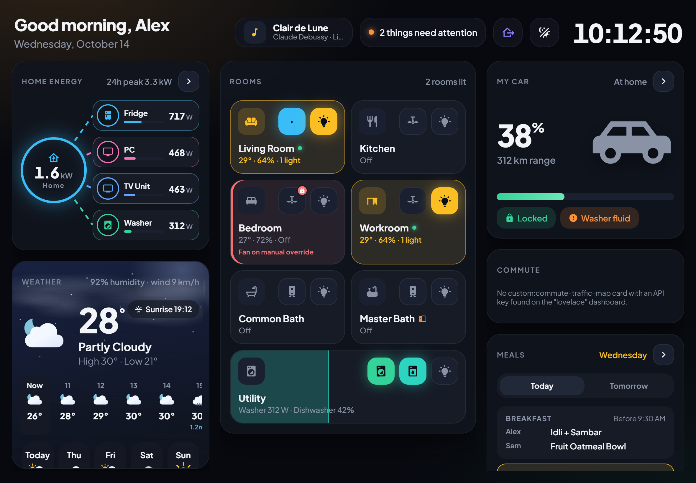
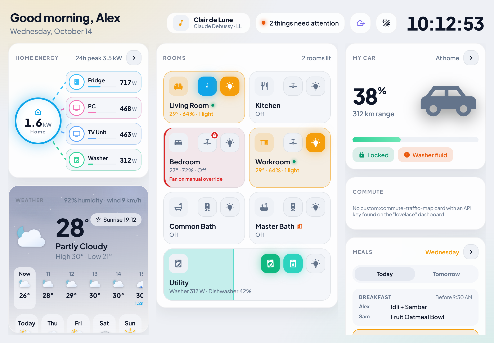

# HA Dashboard

A fast, kiosk-friendly Home Assistant dashboard written in React. It replaces Lovelace on a wall-mounted iPad, a phone and the desktop, and keeps itself up to date: merge a PR and every screen in the house reloads into the new release.



<table>
  <tr>
    <td width="62%"></td>
    <td></td>
  </tr>
</table>

<sub>Screenshots use the built-in mock with a fictional home.</sub>

## Highlights

- **Three layouts**: a 3-column tablet kiosk, a 4-column desktop, and a phone layout with bottom tabs (`?layout=tablet|desktop|phone`, or picked from the viewport).
- **Rooms at a glance**: one-tap lights and fan/geyser buttons, presence, temperature and humidity, and long-press for brightness or fan speed.
- **Live energy tree**: the top consumers right now. New smart plugs are discovered automatically, with no list to maintain.
- **Weather** with animated skies, plus a car card, commute traffic (Google Routes), media, appliances and a meal plan.
- **Instant loads**: a single self-contained file that paints from a cached snapshot in ~80 ms, then syncs live over the HA WebSocket API.
- **Themes** follow the sun (`?theme=auto|dark|light`).

## Quick start

```sh
npm install
npm run mock     # offline preview with fake data on http://localhost:5173
npm run dev      # live against HA (set VITE_HA_URL=http://homeassistant.local off-box)
npm run build    # dist/index.html (the app) + dist/config.js (your config)
```

Each device logs in to HA once through the normal OAuth screen and keeps its own token.

## Your config

The app itself contains no entity IDs. Everything specific to a home (rooms, devices, names, the meal plan) lives in **`config/dashboard.config.ts`**. That file is gitignored, compiled to a small `config.js`, and deployed next to `index.html`.

```sh
cp config/dashboard.config.example.ts config/dashboard.config.ts   # then edit
python scripts/deploy.py --config-only                              # push config.js to HA
```

The schema, with comments, is in [`src/config/types.ts`](src/config/types.ts).

## Releases and deploys

Versions follow [SemVer](https://semver.org) and are derived from [Conventional Commit](https://www.conventionalcommits.org) PR titles. PRs are squash-merged, and CI checks the title:

| PR title | Release |
|---|---|
| `fix: …` / `perf: …` | patch, 1.2.**3** |
| `feat: …` | minor, 1.**3**.0 |
| `feat!: …` or a `BREAKING CHANGE:` footer | major, **2**.0.0 |
| `docs:` / `chore:` / `refactor:` … | no release |

When a merge to `main` produces a release, GitHub Actions:

1. tags `vX.Y.Z`, updates [`CHANGELOG.md`](CHANGELOG.md) and publishes a GitHub Release with the built `index.html`;
2. joins a Tailscale network as a short-lived node and calls a Home Assistant webhook;
3. HA downloads the release and bumps `input_text.dashboard_build`, and every open dashboard reloads within seconds.

HA stays off the internet and GitHub never holds an HA token. One-time setup: [docs/home-assistant.md](docs/home-assistant.md).

**Manual deploy** (no CI, or for testing): mount the HA `config` Samba share, then run `python scripts/deploy.py`.

## Kiosk URLs

```
http://homeassistant.local/local/dashboard/index.html?layout=tablet
http://homeassistant.local/local/dashboard/index.html?layout=phone
```

## Security and privacy

- HA serves `/local/` without authentication, so neither file holds secrets. Every data call needs the device's own OAuth token. The Google Maps key is read at runtime from your Lovelace config over the authenticated WebSocket.
- Personal data stays out of git: your config and owner notes are gitignored, and `scripts/privacy-check.sh` (a pre-commit hook plus a CI step) blocks commits containing private patterns. Enable the hook with `git config core.hooksPath .githooks`.

## Credits

Weather icons by [Meteocons](https://meteocons.com) (MIT). Icons from [Material Design Icons](https://pictogrammers.com/library/mdi/). Font: Plus Jakarta Sans. Contributor and AI-agent guide: [AGENTS.md](AGENTS.md).
