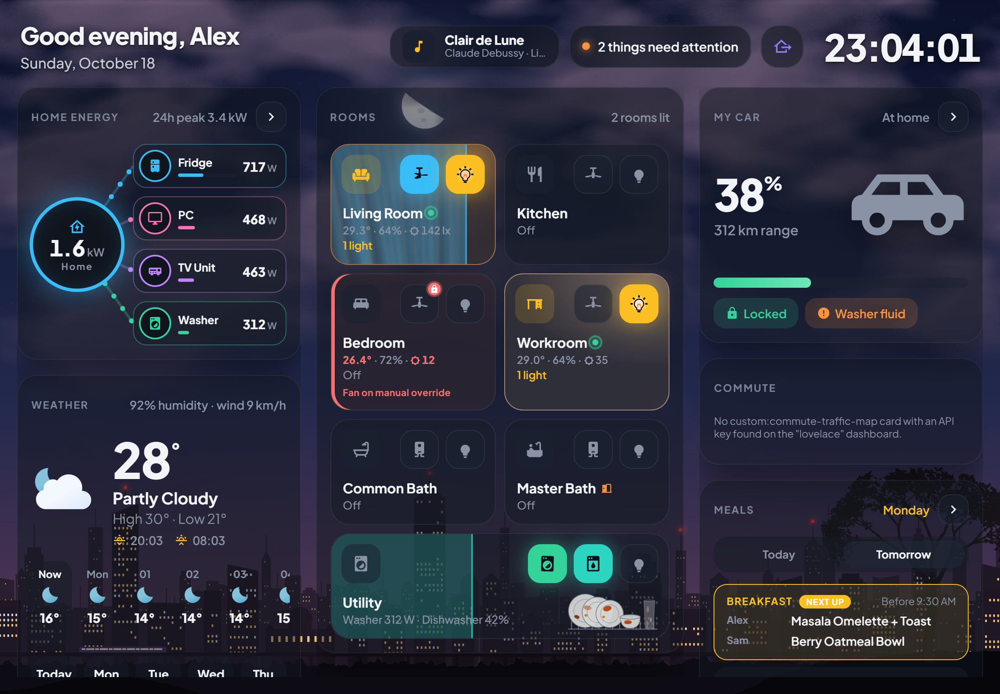
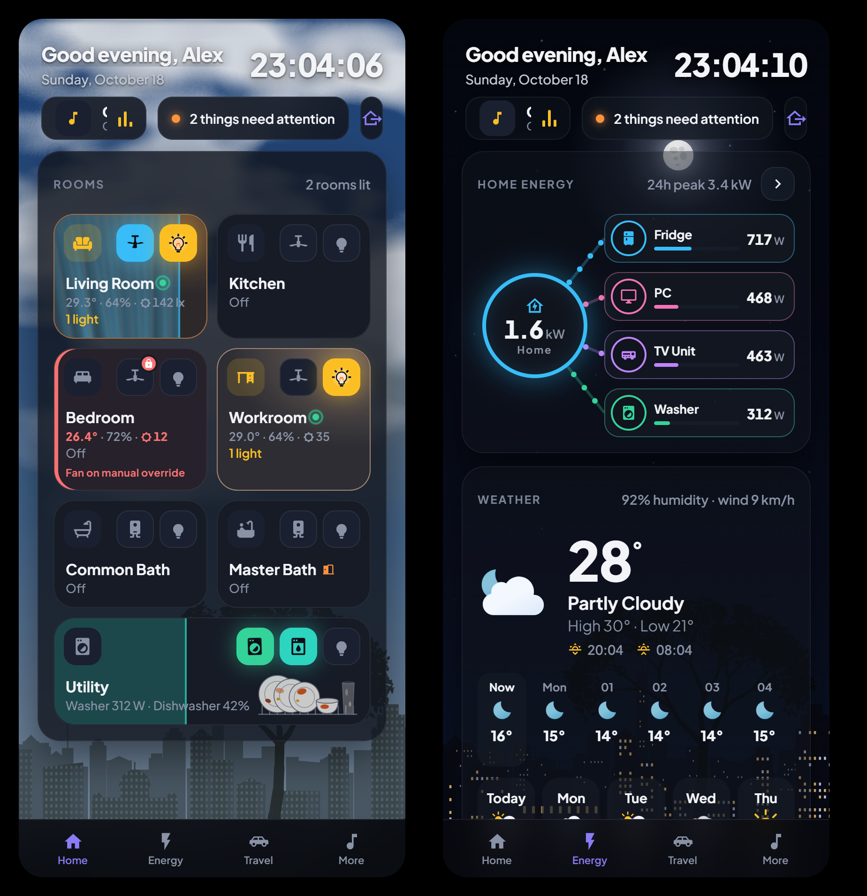

# HA Dashboard

A fast, kiosk-friendly Home Assistant dashboard written in React. It replaces Lovelace on a wall-mounted iPad, a phone and the desktop, and keeps itself up to date: merge a PR and every screen in the house reloads into the new release.



<p align="center"></p>

<sub>Screenshots use the built-in mock with a fictional home.</sub>

## Highlights

- **Three layouts**: a 3-column tablet kiosk, a 4-column desktop, and a phone layout with bottom tabs (`?layout=tablet|desktop|phone`, or picked from the viewport).
- **Rooms at a glance**: presence, temperature, humidity and light level, plus one-tap control chips that say what's on: brightness, fan speed, how long the geyser has been on, when the dishwasher finishes. Each room's fan speed is drawn across its card; slide sideways to change it.
- **Live energy tree**: particles flow to the top consumers right now, each at a speed set by that plug's own draw; 30 days of daily kWh in the Power popup. New smart plugs are discovered automatically.
- **Weather** with hourly and daily forecasts, sunrise and sunset, and a rain-coming heads-up, plus a car card (optionally a 3D model of your car in your paint colour, showing open doors, lights, heaters and warnings where they are on the car, that you can turn and sit inside; with remote climate, refresh, hazards and horn), commute traffic (Google Routes), media, appliances and a meal plan.
- **Alive, not busy**: lit rooms glow, a soft breeze drifts across rooms with a fan on, cards zoom into their details, and full-screen animated alerts (with a soft chime) say when the washer is done, a door is left open, or a Home Assistant automation notifies the phones. A doorbell press brings the door camera up full screen.
- **Night screen** on the kiosk: a dim, burn-in-safe clock after a few idle minutes at night.
- **Instant loads**: a single self-contained file that paints from a cached snapshot in ~80 ms, then syncs live over the HA WebSocket API.
- **A living city skyline** behind everything, in a dark theme: towers that light up floor by floor at night, a metro line, and a sky that follows the sun, the moon's place and phase, clouds, rain, thunderstorms and humidity; the wind shows in the swaying tree, drifting clouds and slanting rain. Add `?skyTest` to try any hour and weather.
- **Installable on the phone**: open it over HTTPS and choose "Install app" / "Add to Home Screen" for a full-screen app.

## Quick start

```sh
npm install
npm run mock     # offline preview with fake data on http://localhost:5173
npm run preview:local   # the test build at http://localhost:4180; open tabs reload on each rebuild
npm run dev      # live against HA (set VITE_HA_URL=http://homeassistant.local off-box)
npm run build    # dist/index.html (the app) + dist/dashboard-config.json (your config)
```

Each device logs in to HA once through the normal OAuth screen and keeps its own token.

Working with Claude Code, the local preview rebuilds by itself after every agent turn (a Stop hook in `.claude/settings.json`), so a tab on http://localhost:4180 always shows the latest change. If the repo lives somewhere that can't hold `node_modules` (such as Google Drive), put `BUILD_DIR=<a local folder>` in `.env.local`.

## Your config

The app itself contains no entity IDs. Everything specific to a home (rooms, devices, names, the meal plan) lives in **`config/dashboard.config.ts`**. That file is gitignored, and it is stored in Home Assistant itself, as a hidden dashboard that only logged-in users can read. The app fetches it after login and keeps a copy on each device, so reloads stay instant.

```sh
cp config/dashboard.config.example.ts config/dashboard.config.ts   # then edit
HA_URL=http://homeassistant.local HA_TOKEN=<admin long-lived token>   python scripts/deploy.py --config-only                            # push it to HA
```

The schema, with comments, is in [`src/config/types.ts`](src/config/types.ts).

## Releases and deploys

Versions follow [SemVer](https://semver.org) and are derived from [Conventional Commit](https://www.conventionalcommits.org) PR titles. PRs are squash-merged, and CI checks the title:

| PR title | Release |
|---|---|
| `fix: …` / `perf: …` | patch, 1.2.**3** |
| `feat: …` | minor, 1.**3**.0 |
| `feat!: …` or a `BREAKING CHANGE:` footer | major, **2**.0.0 |
| `docs:` / `chore:` / `refactor:` … | no release |

When a merge to `main` produces a release, GitHub Actions:

1. tags `vX.Y.Z`, updates [`CHANGELOG.md`](CHANGELOG.md) and publishes a GitHub Release with the built `index.html`;
2. joins a Tailscale network as a short-lived node and calls a Home Assistant webhook;
3. HA downloads the release and bumps `input_text.dashboard_build`, and every open dashboard reloads within seconds.

HA stays off the internet and GitHub never holds an HA token. One-time setup: [docs/home-assistant.md](docs/home-assistant.md).

**Manual deploy** (no CI, or for testing): mount the HA `config` Samba share, then run `python scripts/deploy.py`.

### Preview

Every push to a pull request, and every release, also deploys a **preview** next to the live dashboard, at `/local/dashboard/preview/index.html` (add `?layout=tablet|phone|desktop`). It's the same test version as `npm run mock`: fake data from the example config and no connection to your home, with the sky test panel open to try any hour, weather, wind, humidity and moon phase. Use it to check a pull request on the iPad or a phone before merging. The live dashboard is never touched, and the preview reloads itself when a newer build lands. One-time setup: section 6 of [docs/home-assistant.md](docs/home-assistant.md).

## Kiosk URLs

```
http://homeassistant.local/local/dashboard/index.html?layout=tablet
http://homeassistant.local/local/dashboard/index.html?layout=phone
http://homeassistant.local/local/dashboard/preview/index.html?layout=tablet   # preview (fake data)
```

## Security and privacy

- HA serves `/local/` without authentication, so the app file holds no secrets and no personal data; the per-home config is only readable after login. Every data call needs the device's own OAuth token. The Google Maps key is read at runtime from your Lovelace config over the authenticated WebSocket.
- Personal data stays out of git: your config and owner notes are gitignored, and `scripts/privacy-check.sh` (a pre-commit hook plus a CI step) blocks commits containing private patterns. Enable the hook with `git config core.hooksPath .githooks`.

## Credits

Weather icons by [Meteocons](https://meteocons.com) (MIT). Icons from [Material Design Icons](https://pictogrammers.com/library/mdi/). Font: Plus Jakarta Sans. Contributor and AI-agent guide: [AGENTS.md](AGENTS.md).
